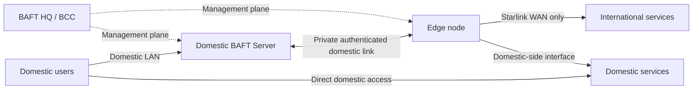

# ADR-004: Hybrid Application Gateway for isolated domestic networks with a Starlink-connected Edge

- **Status:** Proposed architecture; implementation not yet authorized by this ADR
- **Date:** 2026-11-01
- **Target:** v0.5.x architecture track; no release claim
- **Owner scenario:** Domestic users and services remain reachable without international connectivity. A domestic BAFT server has no international route. A separate Edge host has a domestic-side connection and a Starlink WAN connection.
- **Related:** [ADR-001](./ADR-001-operation-evidence-and-truthful-readiness.md), [ADR-002](./ADR-002-c-baft-capability-integration.md), [ADR-003](./ADR-003-real-host-public-ingress.md), [v0.5.0 baseline audit](./BASELINE_AUDIT.md), Issue #67, Issue #269

## 1. Executive decision

Adopt a **Hybrid Application Gateway** as the first architecture to investigate and prototype. Do not make the domestic BAFT server an Internet gateway and do not add a default route through Starlink.

The domestic server remains the local control point for user identity, policy, sessions, accounting and local audit. A separately enrolled Edge node is the only component connected to Starlink. The Edge also has a separately controlled domestic-side connection to the domestic server and permitted domestic services.

External requests are relayed at the application layer through a narrowly defined, authenticated broker. Domestic services continue to be reached directly and independently of Starlink.

This ADR does **not** claim that BAFT currently implements a general-purpose application proxy, SOCKS/HTTP proxy, IP router, VPN gateway or arbitrary-protocol relay. The current BAFT data plane and the proposed application relay are different capabilities. The first prototype must explicitly enumerate supported request types and must refuse everything else.

## 2. Physical and logical topology

### 2.1 Physical topology

The diagram expresses logical reachability, not a claim that interfaces, routes, ACLs or a physical LAB have already been configured.

### 2.2 Security zones

| Zone | Members | Allowed purpose | Explicitly not allowed |
|---|---|---|---|
| Z-DOMESTIC | users, domestic BAFT server, approved domestic services | Local user access, BCC control, domestic service access | Default route or transit to Starlink |
| Z-EDGE-DOMESTIC | Edge domestic NIC and its authenticated server/service peers | Narrow Server–Edge control/data channel; explicitly allowlisted domestic dependencies | General inbound access from domestic LAN to Edge processes |
| Z-EDGE-WAN | Edge Starlink NIC | Outbound connections to approved external destinations | WAN-initiated access to Z-DOMESTIC; forwarding arbitrary packets between zones |
| Z-MANAGEMENT | BCC/HQ and enrolled node management endpoints | Signed policy, node health, bounded telemetry | Being a required hop for user traffic |
| Z-AUDIT | local journals and later central aggregation | Append local evidence and synchronize later | Making request availability depend on central Journal reachability |

### 2.3 Network invariants

1. The domestic server has no Starlink interface, no international default route and no IP forwarding to the Edge.
2. The Edge's domestic and Starlink interfaces are distinct. Policy routing and firewall rules must prevent accidental bridging, forwarding and asymmetric reply paths.
3. Domestic user-to-domestic-service traffic remains direct. It must not hairpin through Starlink or depend on the Edge.
4. Only the Edge originates approved external connections. No unsolicited WAN connection may enter the domestic zone.
5. HQ/BCC is the management authority, not a data-plane dependency. Loss of HQ must not erase a still-valid local policy or interrupt already-authorized domestic traffic.
6. If the Edge or Starlink fails, external requests fail closed while domestic traffic continues.
7. If the central Journal is unavailable, nodes retain bounded local audit records and synchronize them later without fabricating success.

## 3. Request model and supported scope

### 3.1 First implementation: application relay, not routed gateway

The first vertical slice is a request/response relay with an explicit protocol contract:

1. A domestic user authenticates to the domestic BAFT service.
2. The domestic service authorizes the requested operation against user policy.
3. The domestic broker creates a bounded request envelope containing a request ID, authenticated principal reference, policy version, expiry, destination identifier, operation, size limits and replay/idempotency key.
4. The domestic server sends the envelope over a mutually authenticated Server–Edge channel.
5. The Edge validates node identity, envelope signature/binding, expiry, destination allowlist, rate/size limits and current policy version.
6. The Edge opens an outbound connection over Starlink to the approved destination, performs the explicitly supported operation and returns a bounded response bound to the same request ID.
7. The domestic server validates the response, records the outcome and returns it to the user.

The relay must not accept arbitrary URL, hostname, IP, port or protocol values from an untrusted user. Destinations are selected by server-side identifiers mapped to signed policy. Redirects, DNS resolution, IPv4/IPv6, private/link-local ranges and DNS rebinding must be checked at connection time, not only at configuration time.

### 3.2 Initial protocol boundary

The prototype should start with one narrowly defined HTTPS request profile (method allowlist, destination allowlist, header allowlist, body and response caps, redirect policy disabled by default). Do not add SOCKS5, CONNECT, transparent proxying, raw TCP/UDP forwarding or arbitrary port forwarding in the first slice.

If a future use case requires general TCP relay, it must be a separate ADR and threat model. If it requires IP routing, it must be a separate routed-gateway design with explicit route ownership, forwarding, NAT, DNS, MTU and rollback gates.

### 3.3 Domestic service routing

Domestic services remain directly reachable by users. The Edge may access only the specific domestic services it needs, through its domestic NIC and explicit allowlists. A request classified as domestic must never be sent to the external relay. If classification is ambiguous, refuse rather than silently route externally.

## 4. BAFT component responsibilities

| Component | Responsibility | Authority boundary |
|---|---|---|
| Domestic BCC / BAFT server | User identity, policy evaluation, request broker, session and accounting state | Sole user-policy decision point for the domestic service |
| Edge Agent | Node identity, relay validation, outbound connector, local audit and health | May execute only signed, bounded relay policy; cannot invent user permissions |
| Server–Edge channel | Confidential, integrity-protected, mutually authenticated transport | Separate node identities; key rotation and revocation required |
| BAFT HQ | Fleet policy authoring, signed distribution, status and evidence review | Must not sit inline on every user request |
| Local Journal | Durable request/effect/result evidence and crash recovery | Local append survives central outage; no false success on uncertain outcomes |

Reuse BAFT's existing signed-job, node identity, expiry/replay, Journal, ownership and truthful-readiness patterns where they fit. Do not bypass BCC authority with a shared bearer token, user-supplied tunnel URL or direct shell command. Do not copy C-BAFT code merely to obtain a proxy feature; ADR-002's licensing and provenance requirements continue to apply.

## 5. Security requirements

### 5.1 Identity and authorization

- Unique enrolled identity and certificate per Edge; mutual TLS on the Server–Edge channel.
- Bind each request to a user principal reference, domestic policy version, Edge identity, destination ID, operation, request ID and expiry.
- Enforce replay protection and idempotency. A duplicate request must not repeat a non-idempotent external effect.
- Revocation and policy expiry fail closed for new external requests.
- Never expose private keys, pairing secrets, bearer tokens or sensitive request bodies in logs, UI, telemetry or GitHub evidence.

### 5.2 Destination and egress control

- Destination allowlists are policy-owned, versioned and signed.
- Resolve DNS at the Edge; validate every resolved address against policy immediately before connect. Revalidate redirects (prefer no redirects initially).
- Deny loopback, link-local, multicast, unspecified, private and domestic management ranges unless a specific reviewed policy explicitly requires a domestic dependency.
- Prevent DNS rebinding, IPv4/IPv6 policy mismatch, SNI/Host mismatch and proxy-style destination overrides.
- Starlink WAN firewall defaults to deny inbound; permit only established return traffic and explicitly required outbound traffic.
- Edge must not route packets between WAN and domestic NICs. Kernel forwarding is disabled unless a future separately reviewed ADR requires it.

### 5.3 Resource and abuse controls

- Strict per-request connect/read/write deadlines, body and response size caps, concurrency caps, per-user and per-destination rate limits, bounded queues and cancellation propagation.
- Backpressure and slow-receiver tests; no unbounded buffering.
- Redact credentials and sensitive headers; minimize content retention. Store metadata and hashes where sufficient.
- Define behavior for partial external effects and uncertain responses. Do not automatically retry non-idempotent operations after an ambiguous timeout.

### 5.4 Failure behavior

| Failure | Required behavior |
|---|---|
| Starlink down / external DNS unavailable | External request fails with explicit reason; domestic service remains available |
| Edge offline | External request fails closed; domestic service remains available |
| HQ/BCC unreachable | Existing unexpired local policy remains usable within its defined lease; no new untrusted policy is accepted |
| Central Journal unavailable | Local bounded Journal continues; later sync is idempotent |
| Server–Edge channel fails | No plaintext fallback and no direct client bypass |
| Policy expired/revoked | New external requests denied |
| Response lost after external side effect | Mark outcome uncertain; do not claim failure-safe retry unless operation is idempotent |

## 6. Threat model and abuse cases

The design must explicitly test: compromised domestic user; compromised Edge process; stolen/revoked Edge certificate; malicious DNS response; DNS rebinding; redirect to a private address; Host/SNI confusion; SSRF; request replay; cross-user request substitution; oversized body/response; slow receiver; queue exhaustion; Edge WAN ingress attempt; route/forwarding leak; IPv6 bypass; policy rollback; clock skew; crash between external effect and response journal; central Journal outage; and malicious or malformed domestic service classification.

A compromised Edge must not gain unrestricted access to the domestic server or services. A compromised domestic user must not turn the Edge into an open proxy. A compromised HQ account must not bypass local node identity, policy expiry or effect fencing.

## 7. Implementation plan and gates

This ADR authorizes design and LAB work only. Runtime implementation is a separate staged change on the v0.5.x development branch, after codebase mapping and acceptance tests are agreed.

| Stage | Work | Exit gate |
|---|---|---|
| HAG-0 Discovery | Map BAFT BCC/Agent/Journal/identity APIs; inspect actual NICs, routes, DNS, IPv6, domestic service dependencies and Edge reachability | Written inventory; no production changes |
| HAG-1 Isolation LAB | Build isolated domestic-server, Edge dual-interface and domestic-service namespaces/VMs; prove bidirectional Server–Edge reachability and return path without changing domestic default route | All zone invariants verified; packet/route evidence saved |
| HAG-2 Relay contract | Define versioned envelope, destination IDs, idempotency, timeout, size limits, response binding and error taxonomy | Positive and negative contract tests; fuzz malformed envelopes |
| HAG-3 Secure relay POC | Implement one HTTPS request profile through signed BCC policy and mTLS Edge channel | Allowed request succeeds; all unauthorized destinations and malformed requests are refused |
| HAG-4 Failure and isolation | Inject Starlink, Edge, HQ, Journal and channel failures; test DNS/IPv6, replay, SSRF, slow receivers and partial effects | No domestic outage, no unauthorized egress, no false success |
| HAG-5 Product integration | Add BCC UI, enrollment/policy lifecycle, telemetry and Persian/English operator explanations | UI backed by real state; no fake readiness; accessible and mobile-tested |
| HAG-6 Release qualification | Exact-SHA CI, security review, isolated multi-node LAB, upgrade/rollback and documentation | All applicable gates pass; release approval remains separate |

### Mandatory LAB scenarios

| ID | Scenario | Acceptance |
|---|---|---|
| LAB-HAG-01 | Domestic server routes | No international default route; no Starlink interface or path |
| LAB-HAG-02 | Edge dual-NIC isolation | No kernel forwarding/bridge between WAN and domestic zones |
| LAB-HAG-03 | Server–Edge reachability | Mutual authentication and bidirectional return path proven |
| LAB-HAG-04 | Domestic service access | User reaches domestic service directly with Edge/Starlink disabled |
| LAB-HAG-05 | Allowed external request | One allowlisted HTTPS operation completes through Edge |
| LAB-HAG-06 | Open-proxy attempts | Arbitrary URL/IP/port/Host/CONNECT rejected |
| LAB-HAG-07 | SSRF and DNS rebinding | Private, loopback, link-local and changed DNS targets refused |
| LAB-HAG-08 | IPv6 and DNS leak | No alternate-family or resolver bypass |
| LAB-HAG-09 | Replay/idempotency | Duplicate request cannot repeat a non-idempotent effect |
| LAB-HAG-10 | Resource bounds | Oversized payload, slow receiver and concurrency exhaustion are bounded |
| LAB-HAG-11 | Starlink failure | External requests fail closed; domestic services continue |
| LAB-HAG-12 | Edge failure | Domestic server and domestic services continue |
| LAB-HAG-13 | HQ failure | Valid local policy remains bounded; expired policy is refused |
| LAB-HAG-14 | Journal outage/restart | Local evidence persists and later sync is idempotent |
| LAB-HAG-15 | Partial external effect | Uncertain outcome is represented honestly; no unsafe automatic retry |
| LAB-HAG-16 | WAN ingress | Unsolicited Starlink-side connections cannot reach domestic services |

Every result must record exact source SHA, topology, test harness, command, exit code and whether it ran in unit, namespace/container LAB, multi-VM LAB or physical environment. A namespace simulation must never be described as a physical Starlink test.

## 8. Non-goals and explicit exclusions

- No international default route on the domestic server.
- No full-device VPN, transparent proxy, general SOCKS/HTTP proxy or arbitrary TCP/UDP gateway in the first implementation.
- No automatic firewall/routing mutation on production hosts during discovery.
- No dependence on HQ or cloud control plane for every user request.
- No claim of Starlink legality, availability, speed or censorship resistance in Iran. Regulatory and provider constraints require separate verification.
- No claim of multi-WAN HA until independent failure domains and failover are tested.
- No use of this architecture to weaken ADR-001's ownership, signed authority, journal, rollback or truthful-readiness invariants.

## 9. Decisions still required before runtime implementation

1. Confirm the initial external HTTPS service/use case and the exact destination allowlist owner.
2. Define which domestic services, if any, the Edge itself must access.
3. Set retention limits for request metadata and response evidence.
4. Confirm certificate issuance/rotation/revocation lifecycle for Edge nodes.
5. Approve a concrete LAB topology and resource budget before provisioning paid infrastructure.

## 10. Current implementation status

- Architecture and acceptance plan: documented by this ADR.
- Existing BAFT signed jobs, Agent identity, Journal and UI: reusable building blocks, not yet proven to implement this gateway.
- Hybrid relay runtime: **not implemented by this ADR**.
- Edge/Starlink physical connectivity: **not tested**.
- Domestic isolation and two-way Server–Edge path: **not tested**.
- Production server configuration: **unchanged**.
- Merge, tag, release and deploy: **not performed**.

